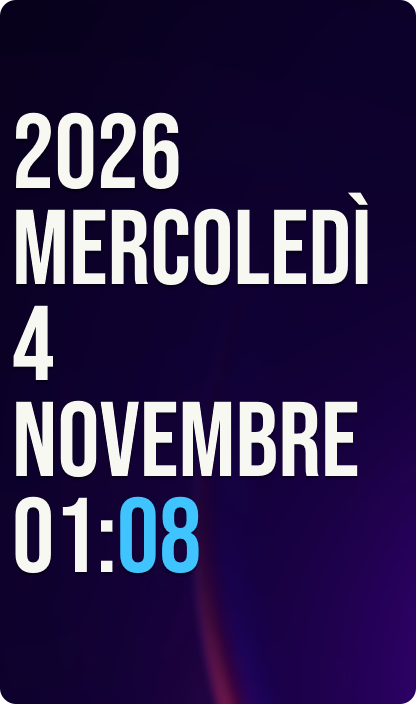
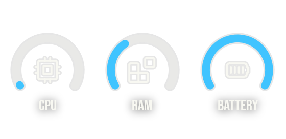
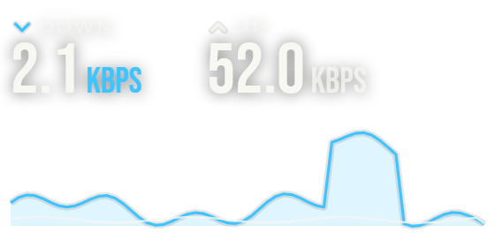
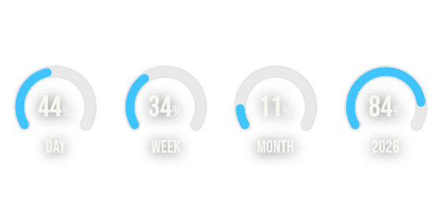

# Sargas for Vitrine

Conky-style widgets for [Vitrine](https://github.com/vitrine-org/vitrine), inspired by
[Sargas](https://www.deviantart.com/zren/art/Conky-Sargas-601690886): a tall stacked date in
Bebas Neue, open arc gauges and the weather told in a sentence, drawn straight on your wallpaper.

| Widget | Size | |
|---|---|---|
| **Date & time**: year, weekday, day, month and time, minutes in the accent color | 2×3 to 6×8 |  |
| **Gauges**: CPU, RAM, battery and optionally a disk as 240° arcs | 3×1 to 6×3 |  |
| **Weather**: today's conditions from [Open-Meteo](https://open-meteo.com), works offline from cache | 4×2 to 7×3 |  |
| **Calendar**: the month name stacked over a bare grid of days, today in the accent color | 2×2 to 5×5 |  |
| **Network**: download and upload speed over a trace of the last minute | 3×1 to 6×3 |  |
| **Time**: how much of the day, week, month and year is gone, as the same 240° arcs | 3×1 to 6×3 |  |
| **To do**: tasks you add, edit and check off with a click, kept in the widget | 2×2 to 5×5 |  |

Every widget has light or dark text, an accent color (or the Windows one), left/center/right
alignment, a soft text shadow and an optional acrylic card for busy wallpapers.

## Install

Download `sargas-2.1.0.vitrine` from the [latest release](https://github.com/vitrine-org/sargas/releases/latest)
and double-click it. Vitrine adds the widgets to its gallery.

The Vitrine 1 theme lives on the [`v1`](https://github.com/vitrine-org/sargas/tree/v1) branch.

## Build

```sh
npm install
npm run pack      # → sargas-2.1.0.vitrine
```

`package.json` depends on `github:vitrine-org/sdk#v2.1.0` (`prompt()` for the to-do list, frosted
glass for the acrylic card). Preview a widget with
`vitrine render dist gauges --cells 4x2 --scale 2 --out gauges.png`.

## License

MIT. Bebas Neue and Montserrat are bundled under the SIL Open Font License 1.1 (see `LICENSE`).
